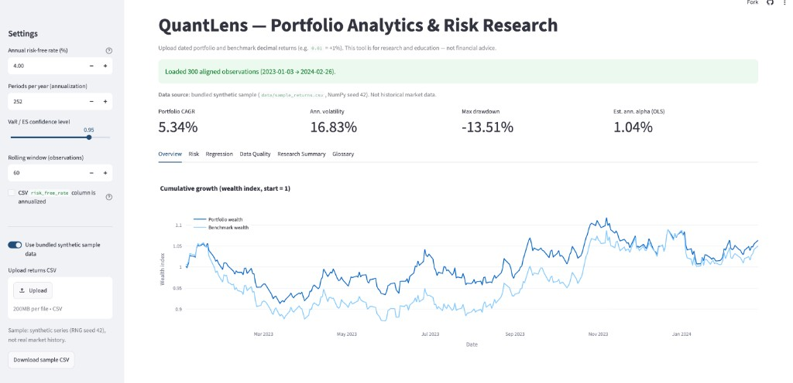
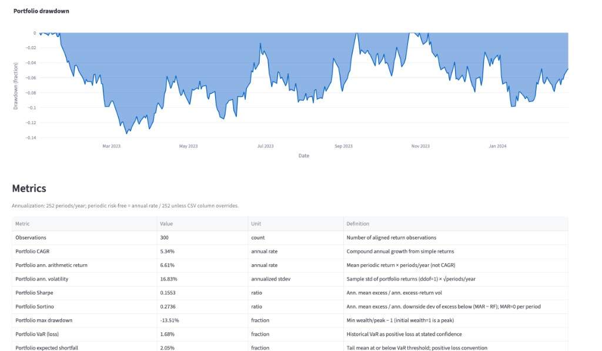
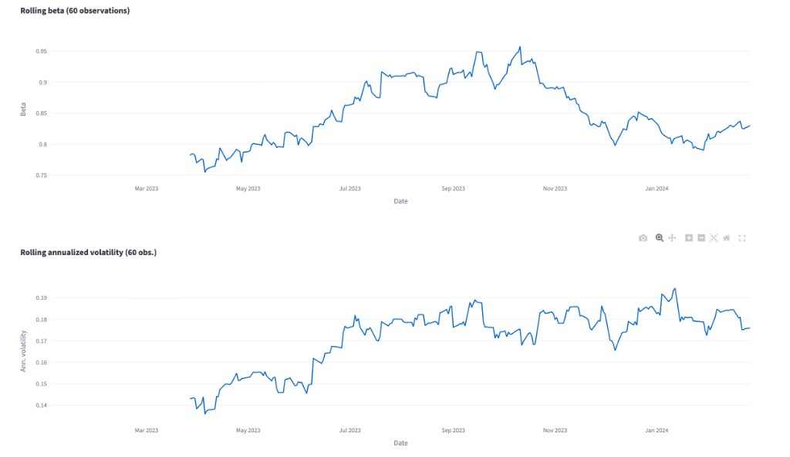
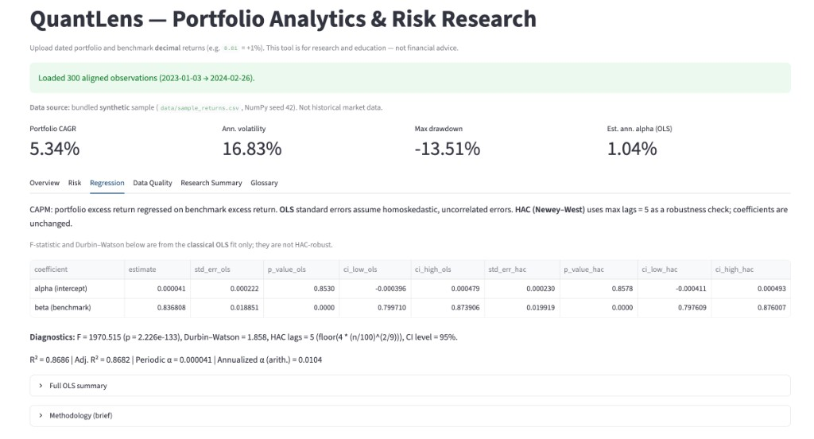

# QuantLens — Portfolio Analytics & Risk Research

QuantLens is a research-oriented application for analyzing **aligned portfolio and benchmark return series**. Given a CSV of dated simple returns, it computes transparent performance and risk metrics, estimates a CAPM linear model with **classical OLS and Newey–West HAC inference reported side by side**, visualizes rolling risk, performs descriptive regime and sensitivity checks, and exports reproducible results. The emphasis is on **quantitative correctness, statistical uncertainty, and reproducibility**—not on marketing claims about alpha.

> **Disclaimer:** QuantLens produces descriptive historical summaries. It is not investment advice and cannot establish manager skill from returns alone.

---

## Overview

Many portfolio summaries report point estimates (CAGR, Sharpe, alpha) without clarifying definitions, annualization, or inference assumptions. QuantLens addresses that gap for a **two-series** setting (portfolio + benchmark):

1. **Validate and align** inputs explicitly (dates, missing values, duplicates).
2. **Document formulas** in code and in [`docs/methodology.md`](docs/methodology.md).
3. **Separate** OLS coefficient estimates from HAC robust standard errors ([`docs/statistical-inference.md`](docs/statistical-inference.md)).
4. **Test** core formulas with hand-calculable pytest cases ([`docs/testing.md`](docs/testing.md)).
5. **Summarize** findings with deterministic text tied to computed outputs (no LLM-generated narratives).

The Streamlit UI (`app.py`) orchestrates the `quantlens` Python package; all displayed values are computed from user or sample data.

---

## Live demo

**[https://quant-lens-ub.streamlit.app/](https://quant-lens-ub.streamlit.app/)**

The hosted app loads the bundled **synthetic** sample by default (not historical market data). Upload your own CSV from the sidebar to analyze custom series.

Local run: [Installation](#installation).

---

## Screenshots

Captured from the live demo with the synthetic sample (300 observations).

| Overview — cumulative growth & KPIs | Drawdown & metrics table |
|:---:|:---:|
|  |  |

| Rolling beta & volatility | CAPM regression (OLS + HAC) |
|:---:|:---:|
|  |  |

---

## Features (implemented)

| Area | Capability |
|------|------------|
| **Data** | CSV upload; validation; optional synthetic sample; JSON/CSV export |
| **Performance** | Wealth curve, drawdown, CAGR, annualized arithmetic return |
| **Risk** | Volatility, Sharpe, Sortino, max drawdown, historical VaR & ES |
| **Relative** | Beta, tracking error, information ratio |
| **Regression** | CAPM OLS; HAC SEs, p-values, CIs; OLS F-stat & Durbin–Watson |
| **Rolling** | Configurable-window beta, volatility, Sharpe (no look-ahead) |
| **Regimes** | Descriptive split when benchmark return ≥ 0 vs &lt; 0 |
| **Robustness** | First/second-half subperiods; optional outlier alpha diagnostic |
| **Research output** | Template-based summary bullets with numeric p-values |
| **Glossary** | In-app definitions (CAPM, kurtosis, Omnibus, rolling metrics, etc.) |

**Not implemented:** multi-factor models, holdings-based attribution, live market data feeds, database persistence, automated hyperparameter search, or walk-forward backtesting.

---

## Methodology

Return definitions, annualization (\(P=252\) default), risk-free conversion (\(r_f = R_f^{ann}/P\)), Sharpe/Sortino conventions, VaR loss sign, and rolling-window rules are specified in:

**→ [docs/methodology.md](docs/methodology.md)**

Implementation references: `quantlens/metrics.py`, `quantlens/data.py`.

---

## Statistical inference

CAPM: regress portfolio excess returns on benchmark excess returns. OLS yields \(\hat\alpha, \hat\beta\); HAC (Newey–West) adjusts **standard errors and confidence intervals only**, not the fitted coefficients. Default HAC bandwidth:

\[
L = \left\lfloor 4 (n/100)^{2/9} \right\rfloor
\]

Full discussion: **→ [docs/statistical-inference.md](docs/statistical-inference.md)** (`quantlens/regression.py`).

---

## Reproducibility

| Input | Convention |
|-------|------------|
| Returns | Simple decimals; \(0.01 = +1\%\) |
| Columns | `date`, `portfolio_return`, `benchmark_return`; optional `risk_free_rate` |
| Alignment | Chronological sort; drop missing returns; **no** zero-fill |
| Demo data | `data/sample_returns.csv` — **synthetic**, seed 42 |
| Historical study | Fetch QQQ/SPY via `scripts/fetch_case_study_csv.py`; verify with `scripts/reproduce_case_study_analysis.py` and [`research/case_study_manifest.json`](research/case_study_manifest.json) |

Uploaded CSVs are processed **in memory** in Streamlit; they are not written to disk by the app.

---

## Testing

```bash
python -m pytest -q
```

**Verified:** 35 tests, all passing (see [`docs/testing.md`](docs/testing.md) for module breakdown, hand-calculable cases, and coverage gaps).

---

## Case study (QQQ vs SPY)

Optional historical workflow (2019–2024 window, Yahoo Finance via `yfinance`). Documented results and reproduction steps:

**→ [docs/case-study-qqq-spy.md](docs/case-study-qqq-spy.md)**

Supporting files: [`research/HISTORICAL_CASE_STUDY.md`](research/HISTORICAL_CASE_STUDY.md), [`research/CASE_STUDY_FINDINGS.md`](research/CASE_STUDY_FINDINGS.md).

---

## Limitations

- Two return series only; linear single-factor CAPM.
- Historical metrics and regression are **in-sample** descriptions.
- OLS F-test and Durbin–Watson are classical, not HAC-robust.
- Regime labels are sign-based, not econometric regime models.
- VaR/ES are empirical quantiles, not GARCH or parametric stress tests.
- Estimated alpha precision depends on sample length and model misspecification.

---

## Installation

**Requirements:** Python **3.14** (see `.python-version`), macOS/Linux/WSL.

```bash
git clone <your-repo-url>
cd quant-lens
python3 -m venv .venv
source .venv/bin/activate          # Windows: .venv\Scripts\activate
pip install -r requirements.txt
streamlit run app.py
```

Open the local URL (typically http://localhost:8501). Enable **Use bundled synthetic sample data** to explore without uploading.

**Deploy (Streamlit Community Cloud):** [Live app](https://quant-lens-ub.streamlit.app/) — main file `app.py`, Python version aligned with `.python-version`.

---

## Technology stack

Direct runtime dependencies (`requirements.txt`):

| Package | Role |
|---------|------|
| Streamlit | Web UI |
| pandas / NumPy | Data alignment & numerics |
| SciPy | Scientific utilities |
| statsmodels | OLS CAPM & HAC inference |
| Plotly | Interactive charts |
| pytest | Automated tests |

Optional (case study fetch only): `yfinance` — not required to run the app or tests.

---

## Repository layout

```
app.py                 # Streamlit entrypoint
quantlens/             # Core library (data, metrics, regression, charts, report, regime, glossary)
tests/                 # pytest suite
docs/                  # Methodology, inference, case study, testing
data/                  # Synthetic sample; format example
research/              # Case study manifest & notes
scripts/               # Fetch & reproduce case study CSV
```

---

## License

Use and modify for research and education.
